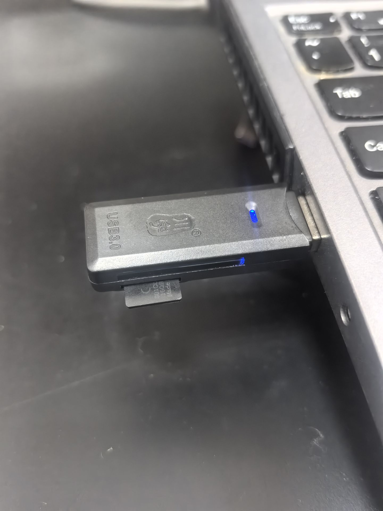
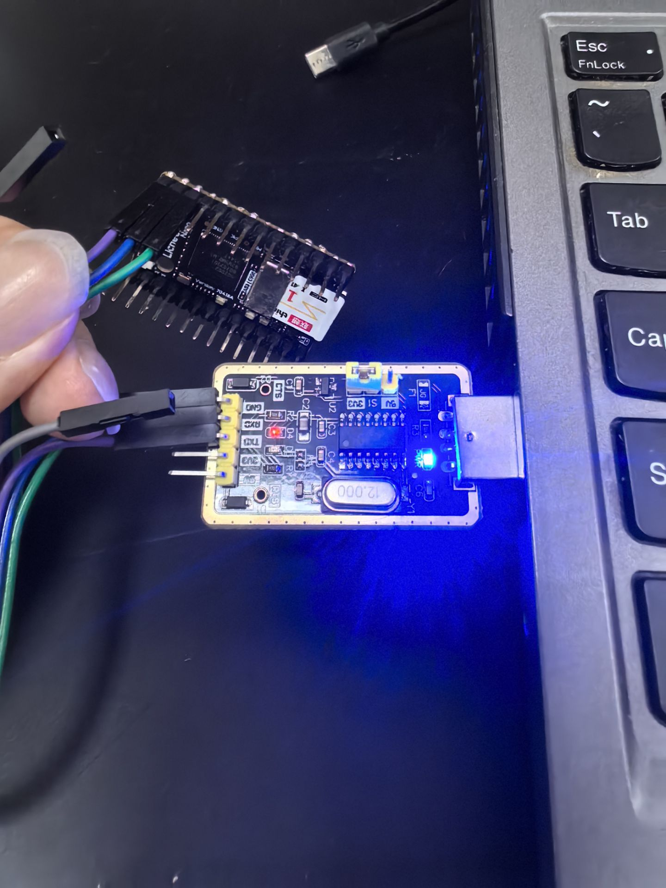

# Intro
该分支记录 Linux baseline 测试流程. 涉及几个仓库:
- [AKA-00](https://github.com/chenlongos/AKA-00), 在当前分支只负责提供一些运行库, 其 release 里面有 image 也要用到
- [akars](https://github.com/chenlongos/akars), 包含网球抓取的一个 rust 用户态程序, 可以在 sg2002 上用 TPU 完成推理

# Env
拉取并编译用户态程序:
```sh
git clone https://github.com/chenlongos/akars.git
cd akars
scripts/setup.sh
scripts/build.sh
```

拉取并编译 `AKA-00` 机器人控制:
```sh
git clone https://github.com/chenlongos/AKA-00.git
cd AKA-00
# 构建（在开发机上执行）
./build_release.sh              # 使用已有前端, 依赖问题可能得自行解决
./build_release.sh --rebuild    # 重新构建前端后打包
# 输出: dist/aka-server (约 9MB 自解压可执行文件)
```

拉取镜像, 并插入前面构建的文件到文件系统中:
```sh
wget https://github.com/chenlongos/AKA-00/releases/download/v0.4/sd_licheervnano_with_AKA00_v0_4.img.xz
xz -d sd_licheervnano_with_AKA00_v0_4.img.xz
sudo losetup -fP --show sd_licheervnano_with_AKA00_v0_4.img
# /dev/loop0, 注意检查你自己的回环设备
sudo mount /dev/loop0p2 /mnt

cd akars
sudo cp target/riscv64gc-unknown-linux-musl/release/akars /mnt/root/
sudo cp yolov8n_tennis_v2.cvimodel /mnt/root

cd AKA-00
sudo cp dist/aka-00-server /mnt/root
sudo umount /mnt
sudo losetup -d /dev/loop0
```

烧录到 SD 卡:



```sh
lsblk   # 需要确定自己的 SD 卡块设备路径
sudo dd if=sd_licheervnano_with_AKA00_v0_4.img of=/dev/sda status=progress   # 注意块设备路径是否正确, 且不加分区编号
```

# Borad Init
将 SD 卡插到 SG2002 上, 先连好串口并启动 `minicom` (或其他串口程序):



```sh
ls /dev | grep -i usb # 检查设备路径
# ttyUSB0
sudo minicom -D /dev/ttyUSB0 -b 115200
```

之后上电观察输出并进入系统, 用户名 `root`, 密码 `root`.

之后运行 `aka-00-server` 程序进行初始化:

```sh
# ls
AKA-00                      akars
aka-00-server               yolov8n_tennis_v2.cvimodel
# ./aka-00-server --init
=== AKA-00 First-Time Setup ===
Installing AKA-00 to /root/AKA-00 ...
Install done.
=== 安装 AP热点 + DHCP(稳定版) ===
wlan0: interface state UNINITIALIZED->ENABLED
wlan0: AP-ENABLED
✅ 热点: chenlong-robot-227229
✅ DHCP已启动
连接后访问: http://192.168.4.1
已启用wlan1 作为wifi连接网口
Setup complete.
  Service will auto-start on next boot.
```

之后在宿主机上也能看到类似 `chenlong-robot-227229` 的 wifi, 连接后就可以通过内网 `ssh` 连接开发板了, 开发板的 ip 是 `192.168.4.1`, 这里用 `iwctl` 连接 wifi 为例:

```sh
iwctl station wlan0 scan
iwctl station wlan0 get-networks
iwctl station wlan0 connect "chenlong-robot-227229" # 注意 wifi 名可能不同
ssh root@192.168.4.1
```

# Network configuration
板子上会有两个无线接口:
```sh
4: wlan0: <BROADCAST,MULTICAST,UP,LOWER_UP> mtu 1500 qdisc mq state UP group default qlen 1000
    link/ether 14:0a:02:d3:77:9c brd ff:ff:ff:ff:ff:ff
    inet 192.168.4.1/24 brd 192.168.4.255 scope global wlan0
       valid_lft forever preferred_lft forever
    inet6 fe80::160a:2ff:fed3:779c/64 scope link
       valid_lft forever preferred_lft forever
5: wlan1: <BROADCAST,MULTICAST> mtu 1500 qdisc noop state DOWN group default qlen 1000
    link/ether 14:0a:02:d3:77:9d brd ff:ff:ff:ff:ff:ff
```
- `wlan0` 用于连接内网
- `wlan1` 用于连接外网

有两种配置外网的方案, 一个是浏览器访问 `192.168.4.1`, 在设置里面手动进行 wifi 连接. 另一种是命令行直接连接, 这里以后者为例 (注意自己填 wifi 名和密码):
```sh
$ cat > wpa_supplicant.conf <<EOF
ctrl_interface=/var/run/wpa_supplicant

network={
    ssid="wifi-name"
    psk="password"
}
EOF

$ wpa_supplicant -B -i wlan1 -c wpa_supplicant.conf
$ udhcpc -i wlan1

$ ip a
4: wlan0: <BROADCAST,MULTICAST,UP,LOWER_UP> mtu 1500 qdisc mq state UP group default qlen 1000
    link/ether 14:0a:02:d3:77:9c brd ff:ff:ff:ff:ff:ff
    inet 192.168.4.1/24 brd 192.168.4.255 scope global wlan0
       valid_lft forever preferred_lft forever
    inet6 fe80::160a:2ff:fed3:779c/64 scope link
       valid_lft forever preferred_lft forever
5: wlan1: <BROADCAST,MULTICAST,UP,LOWER_UP> mtu 1500 qdisc mq state UP group default qlen 1000
    link/ether 14:0a:02:d3:77:9d brd ff:ff:ff:ff:ff:ff
    inet 192.168.43.171/24 brd 192.168.43.255 scope global wlan1
       valid_lft forever preferred_lft forever
    inet6 fe80::160a:2ff:fed3:779d/64 scope link
       valid_lft forever preferred_lft forever
```

如果你在 wifi 所在局域网, 就能直接 `ssh` 连接了:
```sh
$ ssh root@192.168.43.171
```

# Inference
```sh
$ cd /root
$ export LD_LIBRARY_PATH=/root/AKA-00/lib:$LD_LIBRARY_PATH
$ ./akars detect yolov8n_tennis_v2.cvimodel AKA-00/images/1.jpeg --out result.jpg
version: 1.4.0
yolov8n_tennis Build at 2026-04-24 12:06:11 For platform cv181x
Max SharedMem size:2167200
[detect] 1 detection(s) on AKA-00/images/1.jpeg
  #0 class=0 score=0.930 box=(cx=329.6, cy=1292.8, w=480.0, h=524.8)
[detect] annotated image written to result.jpg
```
耗时大概 `60s`, 可以自行修改该程序打印一些时间信息.

StarryOS 上运行的输出为:
```
root@starry:/root # version: 1.4.0
yolov8n_tennis Build at 2026-04-24 12:06:11 For platform cv181x
Max SharedMem size:2167200
[detect] model loaded in 4062.3 ms
[tpu] decode=2430441 us, resize=66111 us, forward=39630 us, postprocess=14278 us
[tpu] draw=1042742.5 ms
[detect] annotated image written to result.jpg
[detect] 1 detection(s) on AKA-00/images/1.jpeg
  #0 class=0 score=0.930 box=(cx=329.6, cy=1292.8, w=480.0, h=524.8)
[detect] timing: load=4062.3 ms, total=1049447.0 ms
```
