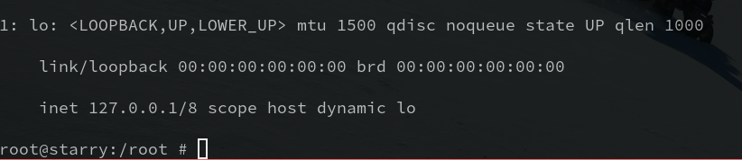
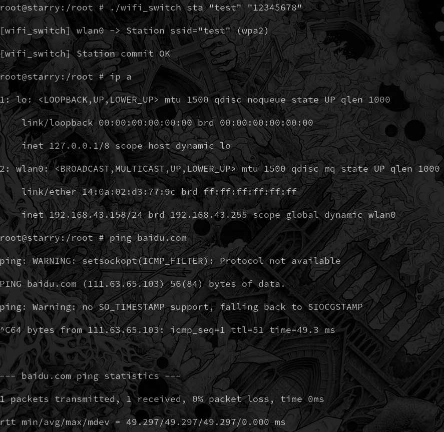
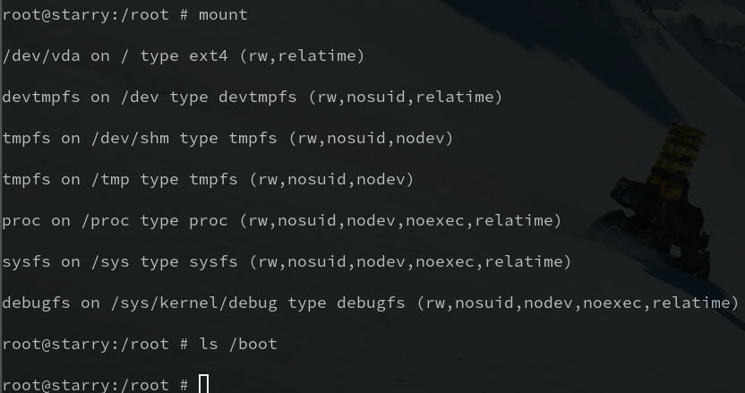
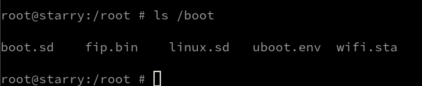
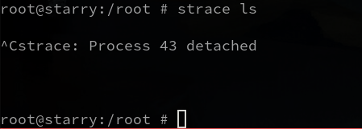
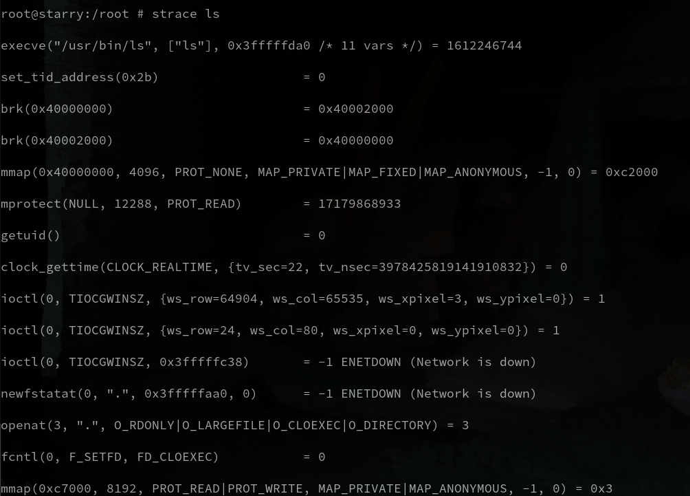
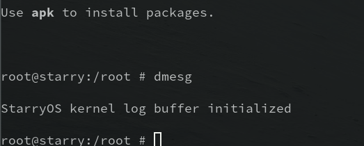
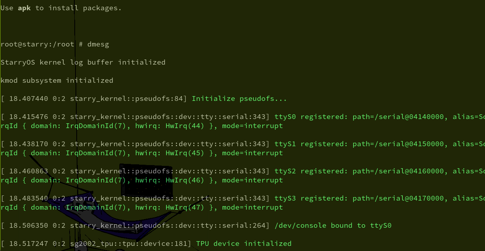
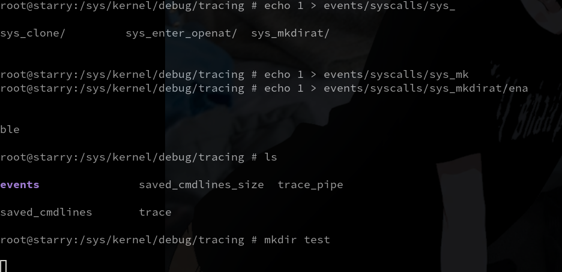
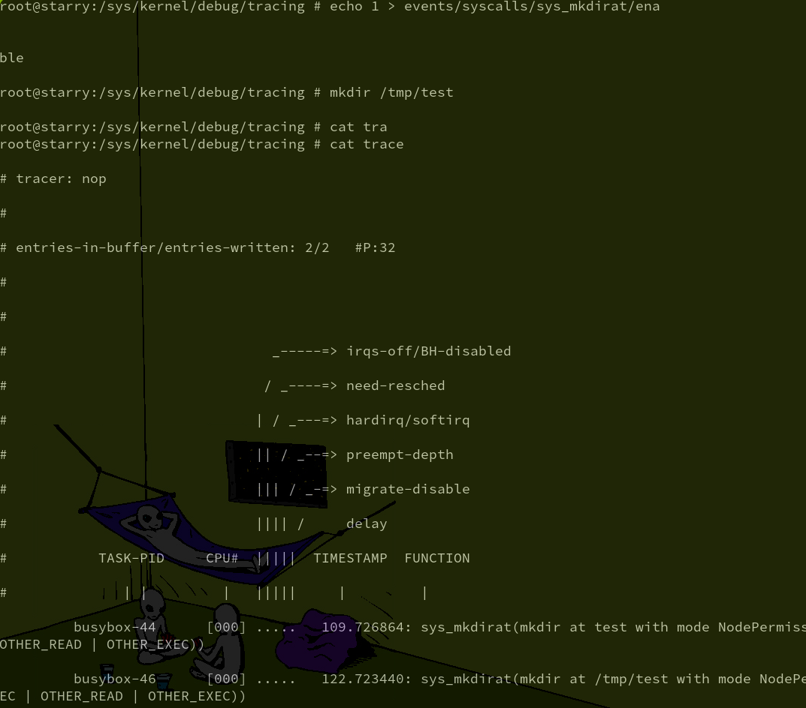

# StarryOS 开发

我们基于 `tgoskits` 仓库的 `main (commit: 1bba09815)` 分支进行开发，对其中的 StarryOS 进行了一定的开发和修补,
本文记录了我们的开发内容

## `/dev/mem` 设备

基于 tgoskits 版本添加 `/dev/mem` 文件

### 修改内容

1. 新增 `kernel/src/pseudofs/dev/mem.rs`

实现了 MemDev 设备，提供三种操作:

- `mmap(offset, length)`  — 返回` DeviceMmap::Physical`，让内核将物理地址直接线性映射到用户空间虚拟地址（uncached）
- `read_at(buf, offset)`  — 通过` phys_to_virt` 将物理地址转虚拟地址后直接拷贝
- `write_at(buf, offset)` — 同上，写方向

2. 修改 `kernel/src/pseudofs/dev/mod.rs`

- 添加 `mod mem`
- 注册 `/dev/mem`（device_id = (1, 1)，使用 Linux 标准）
- pinmux 的 device_id 冲突：(1, 1) → (1, 254)

补丁 [dev](./patch/dev_mem_gpio_2026-07-17_1bba09815.md)

## GPIO 设备

[技术参考手册](https://github.com/sophgo/sophgo-doc/blob/main/SG200X/TRM/contents/cn/peripherals/gpio.rst)

### 修改内容

1. `os/StarryOS/kernel/src/pseudofs/dev/gpio.rs`

- `read_at` : 返回 4 组 GPIO 寄存器的可读状态（DR/DDR/EXT），便于 `cat /dev/gpio` 调试
- `write_at`: 文本控制接口，例如 `echo "0 6 out" > /dev/gpio`（设 GPIO0 第6脚为输出）、`echo "0 6 1" > /dev/gpio`（输出高电平）
- `ioctl`   : 三个命令 —` GPIO_SET_DIR(0x01)`、`GPIO_SET_VAL(0x02)`、`GPIO_GET_VAL(0x03)`，均通过 `GPIOOp { group, offset, value }` 结构体传参
- 封装了 `read_register`、`modify_register`、`read_pin`、`write_pin`、`set_direction` 等 MMIO 底层操作

2. `os/StarryOS/kernel/src/pseudofs/dev/mod.rs:`

- 添加 `mod gpio`
- 在 `builder()` 的 #[cfg(feature = "sg2002")] 块中注册 `/dev/gpio` (设备号 1, 253)

补丁 [gpio](./patch/dev_mem_gpio_2026-07-17_1bba09815.md)

## WiFi

### 旧内核

#### `aic8800.rs`

wifi 的 硬件驱动为 `ax-driver/src/net/aic8800.rs`

但该文件存在错误，启用 IRQ 的时机有问题，会导致驱动配置时超时

> [ 79.050738 ax_driver::net::aic8800:140] [wifi] SDIO1 HW init (node=wifi-sd@4320000, sdio1=0x4320000)  
> [ 79.062438 ax_driver::net::aic8800:149] [wifi] SDIO1 IRQ resolved to IrqId { domain: IrqDomainId(7), hwirq: HwIrq(38) }  
> [ 79.128694 sdhci_cv1800:641] [SDIO] VENDOR_MSHC_CTRL: 0x00000302 -> 0x00010302  
> [ 79.137495 ax_driver::net::aic8800:165] [wifi] SDIO device: vendor=0xc8a1 device=0x0082  
> [ 79.146943 aic8800::wireless:34] [aic8800] chip=Aic8800D80 vid=0xc8a1 did=0x0082  
> [ 79.155901 aic8800::fw:112] [aic8800] firmware_init: chip=Aic8800D80  
> [ 79.168835 aic8800::fw:84] [aic8800] V3 SDIO ready (sleep_reg=0x10)  
> [ 79.596631 aic8800::fw::firmware::upload:59] [aic8800] Firmware uploaded (337184 bytes)  
> [ 79.644539 aic8800::fw::firmware::upload:206] [aic8800] AIC8800D80 firmware init done  
> [ 79.653813 aic8800::fw:174] [aic8800] Firmware init complete  
> [ 79.660965 aic8800::wireless:53] [aic8800] firmware loaded  
> [ 79.873060 aic8800::fdrv::core::init:150] [fdrv] flow_ctrl OK, reg=0x03, val=127 (raw=0x7f)  
> [ 79.936232 ax_driver::net::aic8800:180] [wifi] chip probe complete  
> [ 79.943802 aic8800::fdrv::wifi::api:360] [WifiClient] === start_ap_open START ===  
> [ 85.952884 aic8800::fdrv::protocol::cmd:237] [cmd_mgr] TIMEOUT waiting for cfm 0x006a (6000ms)  
> [ 85.962962 aic8800::fdrv::protocol::cmd:249] [cmd_mgr] send_cmd 0x0069 error: Timeout  
> [ 85.972380 ax_driver::net::aic8800:186] [wifi] AP start failed: Other(ConnectionTimeout)  
> [ 85.982083 rdrive:164] Probe failed for [AIC8800 WiFi (CV181x SDIO)]: other error: [wifi] AP start failed: Other(ConnectionTimeout)

因此将 axklib::irq::enable(irq_handle) 从 start_ap_open() 之后移到之前。现在的顺序是：

> aic8800::probe(sdio) → enable(irq_handle) → start_ap_open() → register wlan0

代码修改见 [wifi-patch](./patch/wifi_2026-07-22_1bba09815.md)

#### `wext.rs`

wifi 接口为 `os/StarryOS/kernel/src/file/wext.rs`

在 starryos 上，wifi 用户态程序缺少一些 ioctl 接口

> root@starry:/root # ./wifi_switch sta UESTC-WiFi ""  
> [wifi_switch] wlan0 -> Station ssid="UESTC-WiFi" (open)  
> ioctl 0x8b00 failed: No such device



#### DNS 自动写入 resolv.conf

内核获取到来自路由的 DNS 后保存在内存里，其他用户态程序不知道，导致无法访问域名，只能访问ip

因此使用回调函数在 DNS 改变时自动写入 `/etc/resolv.conf`

| 文件                              | 改动                                                           |
|-----------------------------------|----------------------------------------------------------------|
| `net/ax-net/src/lib.rs`           | DNS 变更回调 + `set_dns_change_callback` + `notify_dns_change` |
| `net/ax-net/src/service.rs`       | `commit_interface_update` 尾部触发通知                         |
| `os/StarryOS/kernel/src/entry.rs` | `write_resolv_conf` 函数 + 回调注册                            |

代码修改见 [dns-patch](./patch/dns_2026-07-22_1bba09815.md)

### 新内核

在 `tgoskits` 仓库中选择 config `licheerv-nano-sg2002-wifi.toml`

```bash
cargo xtask starry build -c os/StarryOS/configs/board/licheerv-nano-sg2002-wifi.toml
```

其中编译到 `aic8800` 时会卡住，因为缺少以为文件，需要从 github 下载，因此构建前需要打开代理

#### 用户态程序

用户态程序在 `tgoskits` 仓库下的 `apps/starry/picoclaw-cli/wifi_switch.c`

具体可参考 `apps/starry/picoclaw-cli/WIFI_SWITCH_DEMO.md`

编译命令

```bash
riscv64-linux-musl-gcc tgoskits/apps/starry/picoclaw-cli/wifi_switch.c -o wifi_switch
```

#### 验证


## FAT 驱动

一开始是没有启用 `fat` feature, 导致默认不会挂载, 但后续启用后会 FAT 还是无法挂载 boot 目录，并且无法访问其中的内容:



原因是 FAT 驱动使用的锁是 `os::sync::{IrqMutex as Mutex, IrqMutexGuard as MutexGuard}` 关闭了中断

1. 将锁换为 `os::sync::{SleepMutex as Mutex, SleepMutexGuard as MutexGuard}` 睡眠锁
2. 判断分区是不是 bootable，是则挂载到 `/boot`



补丁 [fat](./patch/fat_2026-07-23_1bba09815.patch)

## `cvi_usb_camera` 和 JPU

`cvi_usb_camera` 管理摄像头和 JPU 设备，但是有时 JPU 解码会出错，但是 camera 不会自动重启，因此摄像头会一直处于不可用状态

而摄像头出错实际上是因为 JPU 出错，JPU 驱动只在初始化时进行软件重置，导致帧缓冲区满，解码出错，从摄像头获取 YUV 图像帧则报告 EIO

因此添加摄像头出错重置机制，并且对图像帧数量做计数，达到一定值后自动软件重置 JPU 以防止缓冲区满

补丁1 [camera](./patch/camera_2026-07-23_1bba09815.patch)

补丁2 [jpu](./patch/jpu-fix_2027-07-29_11ba09815.patch)

## strace 修复

### 问题

> root@starry:/root # strace ls  
>  
> ^Cstrace: Process 51 detached

strace 没有输出，ls 的输出也没有



### 问题原因

1. `syscall/task/ptrace.rs`

strace 使用系统调用

```c
ptrace(PTRACE_SEIZE, pid, 0, PTRACE_O_TRACESYSGOOD | PTRACE_O_TRACEEXEC)
```

在 starryos 中，传入 `sys_ptrace` 的 `data` 参数包含选项，也就是 `PTRACE_O_TRACESYSGOOD | PTRACE_O_TRACEEXEC`

但是 `ptrace` 的实现有问题

```rust
PTRACE_SEIZE => ptrace_seize(pid, addr) // 这里传入了 addr
```
应该修改为

```rust
PTRACE_SEIZE => ptrace_seize(pid, data)
```
由于 `PTRACE_O_TRACESYSGOOD` 从来没有被设置，tracee 的系统调用停止信号是原始 `SIGTRAP(5)` 而不是 `SIGTRAP` | `0x80(0x85)`。`strace` 收到后把系统调用停止错误归类为信号投递停止（而非系统调用停止），所以：

- 它注入 `SIGTRAP` 回 tracee（而不是调用 `get_scno()` 读寄存器）
- 它永远不进入 `trace_syscall()` 路径
- 没有系统调用输出

2. `task/signal.rs: wait_ptrace_resume(...)`

原代码在被 `task.interrupt()` 打断时调用 `clear_ptrace_stop()` 清空 `exec-stop` 记录，导致 tracer 永远收不到 `SIGTRAP`。退出和 `SIGKILL` 路径已通过独立机制唤醒，不需要 `interruptible`。

```rust
if wait_result.is_err() {
    clear_ptrace_stop() // 清除了记录
}
```

3. `task/signal.rs: check_signals(...)`

tracer 注入相同信号（如 `PTRACE_SYSCALL(data=SIGSTOP)`）后，原代码继续执行 `do_job_stop`，把 tracee 卡在 job-control stop，而 tracer 的 `waitpid(WALL)` 检测不到（需要 `WUNTRACED`），形成死锁。修复后信号被标记为已消费。


3. `task/user.rs`

`new_user_task(...)` 中检查顺序有误

```diff
- syscall exit trace 检查
- exec-stop 检查
+ exec-stop 检查            // 先检查
+ syscall exit trace 检查   // 后检查
```
符合 Linux 语义：exec-stop 应当替代（supersede）syscall exit stop，而非在其之后发生。

此时有:



补丁 [strace-fix-patch](./patch/strace-fix_2026-07-24_1bba09815.md)

## dmesg

### 问题

原本的 `dmesg` 命令无法查看系统日志，`info!()` 等日志输出不进入 `dmesg` 缓冲区

```
info!() → ax_log → LogIfImpl::console_write_str → ax_hal::console → UART 串口

dmesg   → sys_syslog syscall → SYSLOG_STATE (HeapRb ring buffer) /只有一条初始信息
```



系统启动信息仅在开机时能看到，后续日志可能走其他串口设备输出，运行 shell 的串口没有混杂输出

因此需要桥接 `dmesg`

### 修改

1. `axruntime/src/lib.rs`

实现注册与调用 logger 的函数

2. `syscall/sys.rs`

`dmesg` 通过 `sys_syslog` 这个 syscall 读取 日志的 ring buffer，修改前没有代码写入 `SYSLOG_STATE` 这个 ring buffer，于是增加一个其中添加内容的函数

另外需要更换锁

因为 `info!()` 等日志可能在任何时候出现，也可能在原子操作时出现，因此不能使用睡眠锁

睡眠锁获取失败时会导致让出 CPU ，切换任务上下文，但是原子操作的意义就是避免切换上下文，因此在睡眠锁获取时会进行检测

```rust
// ax_sync::Mutex

fn lock(&self) {
    might_sleep();                          // ← 检查：当前是否在原子上下文中？
    let current_id = current().id().as_u64();
    // CAS 获取锁，失败时阻塞当前任务（让出 CPU）
}
```

`might_sleep` 的检查逻辑

```rust
fn might_sleep() {
    if AtomicContextSnapshot::capture().is_atomic() {
        panic!("sleeping not allowed in atomic context");  // ← 直接 panic
    }
}
```

因此使用睡眠锁会导致 panic

使用自旋锁则没有这个问题，因为自旋锁只会 CAS 循环并关抢占，上下文不切换

而且写日志的操作很迅速，只需进行向 ring buffer 中写入字符串，即进行内存复制，速度非常快，因此也不存在性能问题

于是做出修改

```diff
 -static SYSLOG_STATE: spin::LazyLock<Mutex<SyslogState>> =
 -    spin::LazyLock::new(|| Mutex::new(SyslogState::new()));
 +static SYSLOG_STATE: spin::LazyLock<SpinNoPreempt<SyslogState>> =
 +    spin::LazyLock::new(|| SpinNoPreempt::new(SyslogState::new()));
```

3. `entry.rs`

注册 `log_writer` ，后续日志都会从 `log_writer` 再走一遍

此时有:



补丁 [dmesg-patch](./patch/dmesg_2026-07-25_1bba09815.md)


## `/root/init.sh` 作为自启动脚本

向仓库中的 `init.sh` 文件中添加一行，扫描 `/root/init.sh` 文件是否可执行，作为启动脚本，可以自动启动 `wifi_switch`，`sshd` 等

## ktracepoint 修复和应用

### 修复 ktracepoint

`os/StarryOS/kernel/src/tracepoint/mod.rs` 中

```rust
fn trace_pipe_push_raw_record(buf: &[u8]) {
        // log::debug!("trace_pipe_push_raw_record: {}", record.len());
        TRACE_STATE.raw_pipe.lock().push_record( // <- lock()
            monotonic_time_nanos(),
            this_cpu_id() as _,
            buf.to_vec(),
        );
        TRACE_STATE.pipe_notify.notify_irq();
    }

    fn trace_cmdline_push(pid: u32) {
        let curr = current();
        let proc_data = &curr.as_thread().proc_data;
        let exe_path = proc_data.exe_path.read();
        let pname = exe_path
            .split(' ')
            .next()
            .unwrap_or("unknown")
            .split('/')
            .next_back()
            .unwrap_or("unknown");
        TRACE_STATE.cmdline_cache.lock().insert(pid, pname); // <- lock
    }
```

两个 lock 使用的是 `Mutex` 锁，该锁是睡眠锁，可能导致上下文切换，因此会做 `might_sleep()` 判断

```rust
#[track_caller]
pub fn might_sleep() {
    let snapshot = AtomicContextSnapshot::capture();
    if snapshot.is_atomic() {
        panic_atomic_sleep(snapshot, core::panic::Location::caller()); // <- panic in atomic context
    }
}
```

以 `trace_cvi_camera_ioctl` 为例，tracepoint 的调用流程是

```
trace_cvi_camera_ioctl()
  → ext_tp.lock()               ← SpinNoPreempt（关抢占，preempt_count++）
    → trace_pipe_push_raw_record()
      → raw_pipe.lock()         ← ax_sync::Mutex（睡眠锁！）
        → lock_plain()
          → might_sleep()
            → is_atomic() 检测 preempt_count != 0
            → panic → 系统挂死
```

然后内核 panic



因此将 tracepoint 中的 `raw_pipe` 和 `cmdline_cache` 改为 `SpinNoPreempt<T>`

### 添加 tracepoint

ktracepoint 库可以很方便地添加 tracepoint

```rust
// 定义一个 trace_cvi_camera_ioctl(cmd, us, ok)
ktracepoint::define_event_trace!(
    cvi_camera_ioctl,
    TP_kops(crate::tracepoint::KernelTraceAux),
    TP_system(camera),
    TP_PROTO(cmd: u32, elapsed_us: u64, ok: bool),
    TP_STRUCT__entry{
        cmd: u32,
        elapsed_us: u64,
        ok: u8,
    },
    TP_fast_assign{
        cmd: cmd,
        elapsed_us: elapsed_us,
        ok: ok as u8,
    },
    TP_ident(__entry),
    TP_printk({
        let name = match __entry.cmd {
            CVI_CAMERA_IOCTL_INIT => "INIT",
            CVI_CAMERA_IOCTL_GET_INFO => "GET_INFO",
            CVI_CAMERA_IOCTL_GET_FRAME => "GET_FRAME",
            CVI_CAMERA_IOCTL_GET_YUV_FRAME => "GET_YUV_FRAME",
            CVI_CAMERA_IOCTL_HARD_RESET => "HARD_RESET",
            _ => "?",
        };
        alloc::format!(
            "{} (cmd={}) elapsed={}us ok={}",
            name, __entry.cmd, __entry.elapsed_us, __entry.ok != 0
        )
    })
);
```
在 `os/StarryOS/kernel/src/pseudofs/dev/cvi_usb_camera.rs` 的 `ioctl` 的最后添加

```rust
...
trace_cvi_camera_ioctl(cmd, elapsed_us, result.is_ok());
...
```

以显示调用时使用的命令，耗时和是否成功

### 使用

ktracepoint 挂载了一个虚拟文件系统，在 StarryOS 中是 `/sys/kernel/debug/tracing`

向相应的 tracer 目录下的 `enable` 文件写入 1 表示开启 trace
向相应的 tracer 目录下的 `enable` 文件写入 0 表示关闭 trace

```bash
echo 1 > /sys/kernel/debug/tracing/events/camera/cvi_camera_ioctl/enable
```

然后可以通过读取 `/sys/kernel/debug/tracing/trace` 文件得到 tracer 打印的日志

```bash
cat /sys/kernel/debug/tracing/trace
# tracer: nop
#
# entries-in-buffer/entries-written: 123/123   #P:32
#
#
#                                _-----=> irqs-off/BH-disabled
#                               / _----=> need-resched
#                              | / _---=> hardirq/softirq
#                              || / _--=> preempt-depth
#                              ||| / _-=> migrate-disable
#                              |||| /     delay
#           TASK-PID     CPU#  |||||  TIMESTAMP  FUNCTION
#              | |         |   |||||     |         |
```

此时有:



补丁 [ktracepoint_patch](./patch/ktracepoint-fix_2026-07-26_1bba09815.md)
