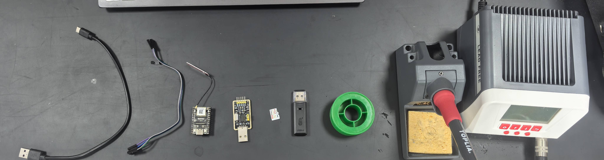
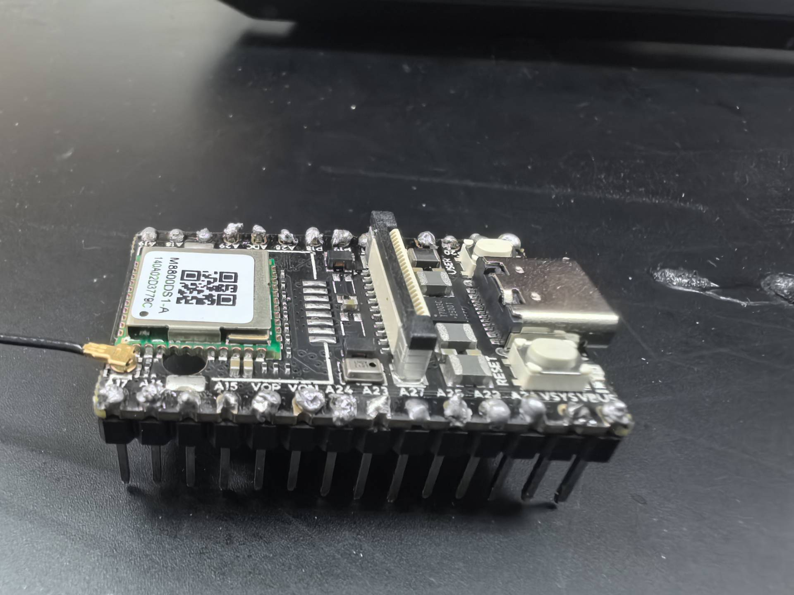
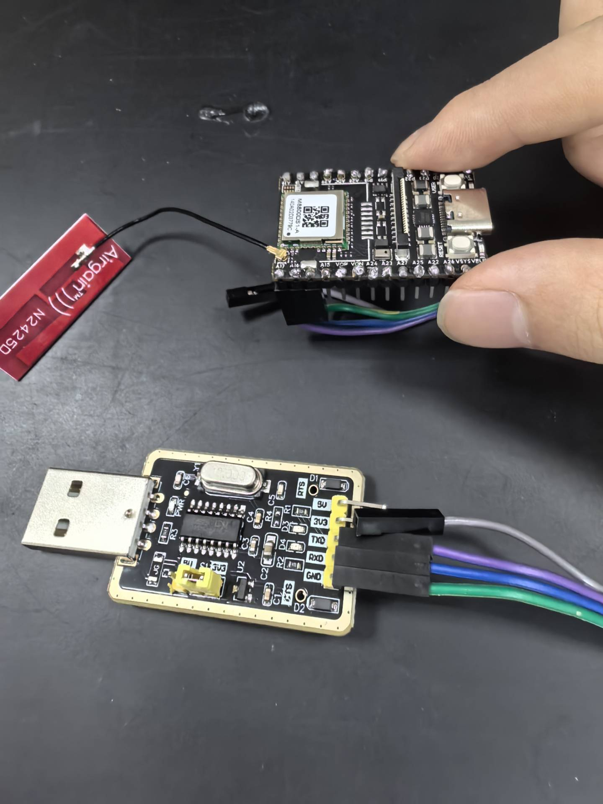
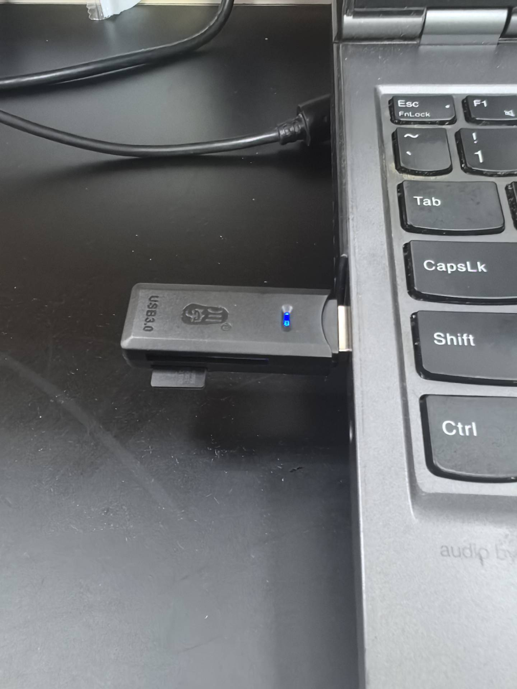
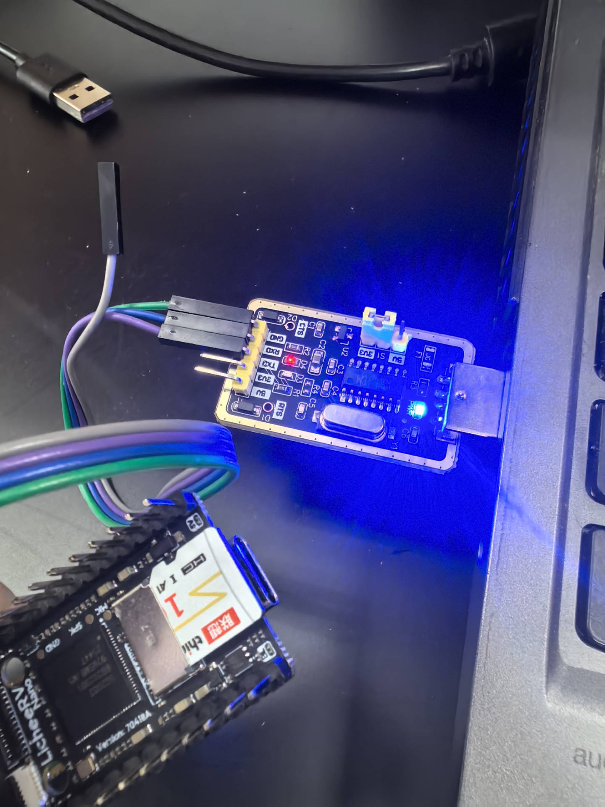
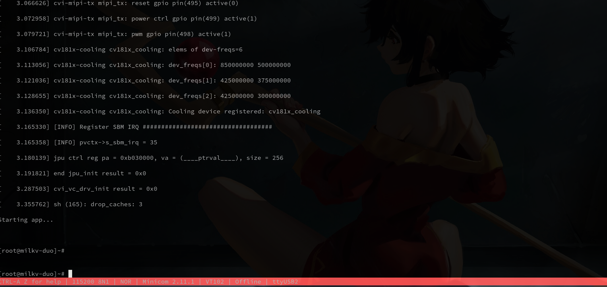
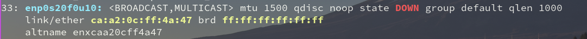
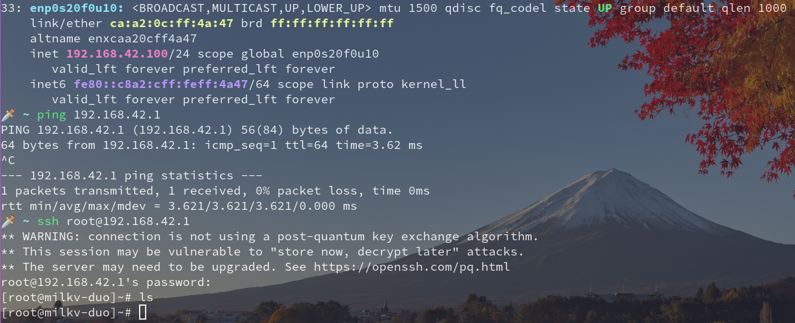

# Intro
该文件记录开发板刚拿到手时, 尝试烧录 Linux 镜像并用串口和 wifi 两种方式查看是否启动的过程. 当时记录时还不清楚 [AKA-00](https://github.com/chenlongos/AKA-00) 仓库下有构建好的 `image`, 因此用的 [milkv-duo](https://github.com/milkv-duo/duo-buildroot-sdk) 的版本 (都在 Releases 下发布有构建好的镜像). 这里保留 merge 之间的文档.

# Resource
所用材料一览如下:

|序号 | 物料                         | 数量  |
|-----|----------------------------|-----|
| 1   | USB-Type C 线               | 1 条 |
| 2   | 杜邦线                        | 3 根 |
| 3   | SG2002 开发板（带 WiFi 版本）      | 1 个 |
| 4   | USB-TTL 转换器                | 1 个 |
| 5   | TF 卡 / microSD 卡（16GB 或更小） | 1 张 |
| 6   | TF 卡读卡器                    | 1 个 |
| 7   | 焊锡丝                        | 1 卷 |
| 8   | 电烙铁                        | 1 个 |



# Prepare
1. 用电烙铁和焊锡丝, 把 SG2002 的引脚接上:



2. SG2002 的 UART0 RX 引脚 (A17) 连接 USB-TTL 模块的 TXD 引脚; UART TX 引脚 (A16) 连接 USB-TTL 模块的 RXD 引脚; GNU 连 USB-TTL 的 GND



3. 根据 [milkv 官网](https://milkv.io/docs/duo/getting-started/buildroot-sdk) 构建 image 镜像 `milkv-duo256m-musl-riscv64-sd_v2.0.1.img`. 或者直接拉取构建好的版本, 之后把 TF 插到读卡器上, 然后插电脑准备写入. 注意先用 `lsblk` 或 `fdisk` 查看自己 TF 卡对应哪一个设备, 是 `/dev/sda` 还是 `/dev/sdb` 或者其他



```sh
$ wget https://github.com/milkv-duo/duo-buildroot-sdk-v2/releases/download/v2.0.1/milkv-duo256m-musl-riscv64-sd_v2.0.1.img.zip
$ unzip milkv-duo256m-musl-riscv64-sd_v2.0.1.img.zip
$ lsblk
NAME                 MAJ:MIN RM   SIZE RO TYPE MOUNTPOINTS
sda                    8:0    1  14.6G  0 disk
$ sudo dd if=milkv-duo256m-musl-riscv64-sd_v2.0.1.img of=/dev/sda status=progress
```

4. 将 TF 卡插到 SG2002 上, 之后先把 USB-TTL 模块插电脑上, SG2002 先不上电 (方便观察开机的启动信息)



5. 用串口工具提前观察输出, 这里用 `minicom`, 也可以用 `screen` 等其他工具. 在给 SG2002 上电之前, 应该是静默状态, 没有任何输出. 这里要注意两个点, 一个是 `sudo` 权限, 另一个是波特率默认是 `115200`

```sh
$ ls /dev | grep -i usb
ttyUSB2
$ sudo minicom -D /dev/ttyUSB2 -b 115200
```
(进入 `minicom` 可能需要先按 `Ctrl-A z` 呼出菜单, 然后按 `E` 关闭本地回显, 最后按 `ESC` 返回)

6. 给 SG2002 上电, 同时观察串口输出, 可以看到能进入系统, 默认 root 密码是 `milkv`



7. 借助 wifi 模块用 ssh 登录 SG2002, 需要配置连接 SG2002 后再本地自动创建的网络接口, 注意先查看设备名. SG2002 的默认 ip 是 `192.168.42.1`



```sh
$ sudo ip addr add 192.168.42.100/24 dev enp0s20f0u10
$ sudo ip link set enp0s20f0u10 up
$ ssh root@192.168.42.1
```



