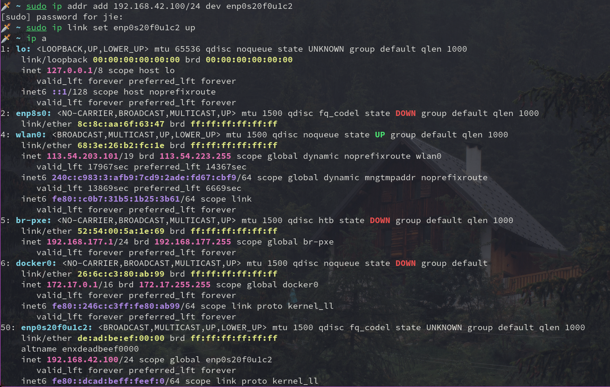
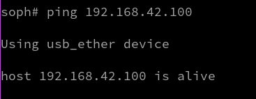

# Intro
`u-boot` 可以设置一个 timeout, 用于给板子上电后考虑进入 `u-boot` 交互界面还是加载操作系统. 只要在 timeout 之前按 `enter` 键, 都能进入 `u-boot`, 后续可以手动加载操作系统.

因此该文档记录 `u-boot` 的手动编译流程, 额外开启功能的代码变更, 以及基本命令的使用介绍. 以适应在 `u-boot` 环境下的操作.

这里基于 `LicheeRV-Nano-Build` 下的 `u-boot` 仓库做变更, 启用了 `saveenv`, `ums`, `rndis` 功能以便于开发. 完整变更在 [pr0f1le/LicheeRV-Nano-Build](https://github.com/pr0f1le/LicheeRV-Nano-Build) 仓库中.

## 编译
拉取 [pr0f1le/LicheeRV-Nano-Build](https://github.com/pr0f1le/LicheeRV-Nano-Build) 和编译链工具:
```sh
git clone https://github.com/pr0f1le/LicheeRV-Nano-Build
cd LicheeRV-Nano-Build
git clone https://github.com/sophgo/host-tools --depth=1
```

仅编译 `u-boot` 和 `opensbi` 拿到 `fip.bin`:
```sh
bash -c "source build/cvisetup.sh && defconfig sg2002_licheervnano_sd && build_uboot"
```

生成的 `fip.bin` 在 `install/soc_sg2002_licheervnano_sd/` 目录下. 之后上板的流程可以回顾 [1_starryos_on_sg2002.md](./1_starryos_on_sg2002.md) 文件.

# u-boot 基础命令
## mmc
MMC (MultiMediaCard), 最初是一种可插拔的闪存卡标准 (类似 SD 的前身), 后来演生成
- eMMC (embedded MMC, 焊在板子上的 Flash, 手机/开发板几乎都是这个)
- SD/SDIO, SD 卡实际上是在 MMC 协议基础上扩展而言

MMC device, 就是 MMC/SD/eMMC 设备的统称.

```u-boot
# 查看有哪些 MMC 设备以及编号
soph# mmc list
cv-sd@4310000: 0 (SD)

# 切换到一个 MMC 设备
soph# mmc dev 0

# 查看当前选中的 MMC 设备编号
soph# mmc dev
switch to partitions #0, OK
mmc0 is current device

# 查看 MMC/SD 卡基本信息（容量、速度等）
soph# mmc info
Device: cv-sd@4310000
Manufacturer ID: 0
OEM: 3432
Name: SD16G
Bus Speed: 50000000
Mode: SD High Speed (50MHz)
Rd Block Len: 512
SD version 3.0
High Capacity: Yes
Capacity: 14.6 GiB
Bus Width: 4-bit
Erase Group Size: 512 Bytes

# 列出 MMC 设备的所有分区
soph# mmc part
Partition Map for MMC device 0  --   Partition Type: DOS

Part    Start Sector    Num Sectors     UUID            Type
  1     1               262144          00000000-01     0c Boot
  2     262145          1572864         00000000-02     83
```

## part
用来查看设备的分区信息:
```
part list <interface> <dev> [partnum]
```
- `<interface>` 指存储接口的类型, 比如 `mmc`, `sata`, `usb`, `nvme`
- `<dev>` 是设备编号 (从 `0` 开始)
- `[partnim]`, 指定查看某个分区详情 (可选)

比如:
```
soph# part list mmc 0
Partition Map for MMC device 0  --   Partition Type: DOS

Part    Start Sector    Num Sectors     UUID            Type
  1     1               262144          00000000-01     0c Boot
  2     262145          1572864         00000000-02     83

soph# part list mmc 1
```
- `mmc 0` 通常是 `SD/microSD`
- `mmc 1` 通常对应板载 eMMC

## printenv
用来查看环境变量的定义信息, 这些变量是由 u-boot 源代码, 板级配置, 编译, 启动阶段共同决定的:

```
┌──────────────────────────────┐
│ 1. 代码中的默认值（C / Kconfig）│ ← 编译阶段固化
├──────────────────────────────┤
│ 2. 板级头文件 / defconfig     │ ← 编译阶段
├──────────────────────────────┤
│ 3. 环境变量存储区（SD/eMMC）   │ ← 运行期可修改
├──────────────────────────────┤
│ 4. 启动脚本 / 命令动态设置    │ ← 运行时临时
└──────────────────────────────┘
```

运行示例:
```
soph# printenv
BOOT_PART_OFFSET=0x0
BOOT_PART_SIZE=0x40000
ROOTFS_PART_OFFSET=0x40000
ROOTFS_PART_SIZE=0x180100
arch=riscv
baudrate=115200
board=cv181x
board_name=cv181x
bootargs=root=/dev/mmcblk0p2 rootwait rw console=ttyS0,115200 earlycon=sbi riscv.fwsz=0x80000 loglevel=9
bootcmd=run sdboot
bootdelay=1
consoledev=ttyS0
cpu=generic
fdtcontroladdr=8a781730
fileaddr=81800000
filesize=c8e328
gatewayip=192.168.0.11
ipaddr=192.168.0.3
netdev=eth0
netmask=255.255.255.0
othbootargs=earlycon=sbi riscv.fwsz=0x80000   loglevel=9
root=root=/dev/mmcblk0p2 rootwait rw
sdboot=setenv bootargs ${reserved_mem} ${root} ${mtdparts} console=$consoledev,$baudrate $othbootargs;echo Boot from SD ...;mmc dev 0 && fatload mmc 0 ${uImage_addr} boot.sd; if test $? -eq 0; then bootm ${uImage_addr}#config-sg2002_milkv_duo256m_musl_riscv64_sd;fi;
serverip=192.168.56.101
stderr=serial
stdin=serial
stdout=serial
uImage_addr=0x81800000
update_addr=0x8b300000
vendor=cvitek
```

这里说明下几个比较重要的变量:
- `bootdelay=1`, 表明 u-boot 启动后 1 秒自动执行 `bootcmd`
- `bootcmd=run sdboot` 是 u-boot 启动后自动运行的命令, `run` 是 u-boot 命令, 作用是执行一个环境变量里的多条命令, `sdboot` 就是一个环境变量名

这里说明下 `sdboot` 包裹的命令:

```
setenv bootargs ${reserved_mem} ${root} ${mtdparts} console=$consoledev,$baudrate $othbootargs
```
- `setenv bootargs`, 设置环境变量 `bootargs`, 作为内核命令行参数. 之后的全部内容就是变量的值
- `${xxx}` 这里的变量有的是普通环境变量, 有的是从源码编译进来的辅助变量
- `;\` 分两部分, `;` 分隔命令, `\` 是续行符

```
echo Boot from SD ...
```
- `echo` 用于打印信息, 后面不需要加引号, 都是会打印的字符

```
mmc dev 0 && fatload mmc 0 ${uImage_addr} boot.sd
```
- `&&` 含义与 Shell 中一致, 前一个命令执行成功后运行后一条指令

```
if test $? -eq 0; then
    bootm ${uImage_addr}#config-sg2002_milkv_duo256m_musl_riscv64_sd;
fi
```
- 同 Shell, `;` 用于分隔, `if ... then ... fi` 是控制块. `$?` 表示上一条命令的返回值
- `bootm` 是启动 uImage/FIT Image 的命令
- `${uImage_addr}` 是内核镜像在内存中的地址
- `#config-xxx` 是 FIT Image 中的一个配置节点

## 查看文件列表
`fatls` 用于查看 FAT 分区的文件内容:
```
soph# fatls mmc 0:1
   468480   fip.bin
 13165352   boot.sd

2 file(s), 0 dir(s)
```

## 文件加载相关
如 `fatload`, 用于从 FAT 分区中读取内容并加载到指定内存位置

```
fatload mmc 0:1 0x40000000 image.fit
```
- `mmc` 指定设备
- `0:1`, `0` 是 MMC 设备号, `:` 是分隔符, `1` 是分区号
- `x40000000` 是要加载到的内存地址
- `image.fit` 是要查找加载的文件名

`ext4load` 用于从 `ext4` 分区加载, 语法与 `fatload` 一致:
```
ext4load mmc 0:1 0x40000000 image.fit
```

`tftpboot` 用于从 TFTP 加载:
```
tftpboot 0x40000000 image.fit
```

`nand` 用于从 raw NAND/NOR 加载:
```
nand read 0x40000000 <offset> <size>
```

## 查看内存内容
`md` (memory display), 从指定地址开始展示内存数据:

```
md <address> <count>
```

默认的显示单元是 `32-bit` word (4 字节), 比如:

```
soph# md 0x40000000 0x40
```

## 按指定配置节点启动
`bootm` (Boot Application Image from Memory), 用于从内存中启动一个 uImage / FIT Image:
```
soph# bootm 0x81800000#conf
```
- `x81800000` 是 FIT Image 在内存的地址
- `conf` 是 FIT 中名为 conf 的配置

## 持久化环境变量
如果启用了 `saveenv`, 则能持久化环境变量, 不需要重新编译.

## YMODEM 文件传输
需要安装 `lrzsz-sb` 工具, `minicom` 背后用这个命令传输:

```sh
$ pkgfile lrzsz-sb
extra/lrzsz
$ sudo pacman -S lrzsz
```

在 U-Boot 命令行输入:
```
=> loady 0x81800000
```
- 意思是将接收的文件放到这个地址

之后如果用 `minicom` 的话, 连接后:
```sh
sudo minicom -D /dev/ttyUSB0 -b 115200
```

按 `Ctrl+A s`, 选择 `ymodem`, 之后选择要传输的文件. 之后手动启动系统可以:

```
soph# bootm 0x81800000#config-sg2002_milkv_duo256m_musl_riscv64_sd
```

# u-boot 新启用命令
## saveenv
`saveenv` 用来保存用 `setenv` 设置的环境变量内容, 默认情况下 `saveenv` 功能没有启用, 即运行了变量的变更还是会丢失, 但在 [pr0f1le/LicheeRV-Nano-Build](https://github.com/pr0f1le/LicheeRV-Nano-Build) 版本中已启用:

```
soph# saveenv
```

## ums
`ums` (USB Mass Storage), 作用是把板子上的某个块设备通过 USB OTF 口模拟成一个 "U 盘", 插到 PC 上后能直接用 `dd`, `mount` 等处理, 不需要网络, 串口来传输文件.

基本语法是:
```
ums <usb_controller> [<devtype>] <dev[:part]>
```
- `<usb_controller>` 是 USB gadget 控制器编号, 一般单 OTG 口填 `0`
- `<devtype>` 是块设备类型, 有 `mmc` (默认), `usb`, `sata`, `scsi`
- `<dev[:part]>` 是设备号, `:part` 用来指定分区, `part` 为 `0` 或不写表示暴露整个设备 (所有分区)

在这里使用之前需要注意, DWC2 OTG 控制器只有一个 UDC (USB Device Controller), 同一时间只能注册一个 USB Gadget Driver, 因此:
- 如果想让 RNDIS 网卡持续保留在宿主机, 则无法在此期间使用 UMS 功能
- 让 RNDIS 网卡只在使用一瞬间保留, 则能同时保留 UMS 功能

这里通过 `usb_eth_persistent` 这个环境变量来控制, 下面是启用 RNDIS persistent mode 的示例:
```
setenv usb_eth_persistent 1
saveenv
reset
```

若要直接用 UMS 功能, 则设置为:
```
setenv usb_eth_persistent 0
saveenv
reset
```

UMS 命令使用示例:
```
# 把 mmc 0（通常是 SD）整盘暴露给 PC
=> ums 0 mmc 0

# 把 mmc 1（通常是 eMMC）暴露给 PC
=> ums 0 mmc 1

# 只暴露 mmc 0 的第 1 个分区
=> ums 0 mmc 0:1

# 把插在开发板 USB host 上的 U 盘转接出去
=> usb start
=> ums 0 usb 0
```

之后在 PC 上先用 `lsblk` 找到这个块设备, 然后挂载即可.

## tftpboot
`tftpboot` 用于用 `tftp` 协议从 server 拉取文件到指定内存位置, 在开启了 RNDIS 或者有物理网口的情况下便于网络传输文件. 这里主要展示一下 USB 网卡启用后的效果.

目前还没有用 `saveenv` 固化 `sdboot`, `ipaddr`, `serverip` 这些环境变量, 这里先手动设置来感受流程.

用串口连接 SG2002 和 PC 后, 查看 USB 设备:
```sh
$ ls /dev | grep -i usb
ttyUSB0
usb
vboxusb
```

之后观察串口:
```sh
$ sudo minicom -D /dev/ttyUSB0 -b 115200
```

在另一个终端观察 `dmesg` 输出:
```sh
$ sudo dmesg -w
```

将 Type-C 线一端接 SG2002, 另一端接 PC, 之后给 SG2002 上电, 进入 U-Boot 后:
```
setenv ipaddr 192.168.42.1
setenv serverip 192.168.42.100
ping 192.168.42.100
```

之后在宿主机终端里查看新的网络接口:
```sh
$ ip a
```


找到后快速设置:
```sh
$ sudo ip addr add 192.168.42.100/24 dev enp0s20f0u1c2
$ sudo ip link set enp0s20f0u1c2 up
```


之后 U-Boot 中的 `ping 192.168.42.100` 会返回则表示连接成功:



在你的电脑上安装 `tftp` 服务并启动, 我这里是 Archlinux:
```sh
sudo pacman -S tftp-hpa
sudo systemctl start tftpd
sudo mkdir -p /srv/tftp
sudo bash -c "echo 'Hello U-Boot' > /srv/tftp/hello.txt"
```

在 U-Boot 内拉取文件并查看:
```
tftpboot 0x84000000 hello.txt
md 0x84000000
```


拉取 `boot.sd` 示例:
```
tftpboot 0x81800000 boot.sd
bootm 0x81800000#config-sg2002_licheervnano_sd
```

