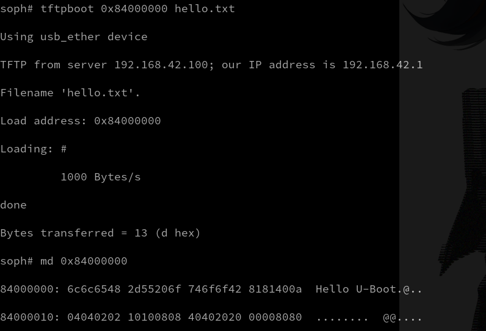

# 变更
该 fork 启用了 u-boot 的 USB Ethernet Gadget 功能, 使得 sg2002 能通过 USB OTG 连接到 Linux 主机时能够作为 USB 网卡使用. 该部分代码由 AI 完成, 我还没有太看明白, 但基本能工作, 后续可能需要清理.

主要变动的文件有:
- build/boards/cv181x/sg2002_milkv_duo256m_musl_riscv64_sd/u-boot/cvitek_sg2002_milkv_duo256m_musl_riscv64_sd_defconfig
- u-boot-2021.10/arch/riscv/include/asm/mach-types.h
- u-boot-2021.10/board/cvitek/cv181x/board.c
- u-boot-2021.10/drivers/usb/gadget/dwc2_udc_otg.c
- u-boot-2021.10/drivers/usb/gadget/dwc2_udc_otg_regs.h
- u-boot-2021.10/drivers/usb/gadget/dwc2_udc_otg_xfer_dma.c
- u-boot-2021.10/drivers/usb/gadget/ether.c
- u-boot-2021.10/drivers/usb/gadget/gadget_chips.h
- u-boot-2021.10/drivers/usb/gadget/rndis.c
- u-boot-2021.10/include/configs/cv181x-asic.h
- u-boot-2021.10/include/net.h
- u-boot-2021.10/scripts/config_whitelist.txt

[USB_GADGET_FIX_NOTES.md](USB_GADGET_FIX_NOTES.md) 和 [USB_GADGET_ARCHITECTURE.md](USB_GADGET_ARCHITECTURE.md) 是两个让 AI 总结的变更描述文件, 可以参考, 但尚未清理.

# 编译
重新编译 U-Boot 得到新的 `fip.bin` 的方式:
```sh
bash -c '
source build/envsetup_milkv.sh milkv-duo256m-musl-riscv64-sd
build_uboot
'
```

之后就能得到我们的目标文件 `install/soc_sg2002_milkv_duo256m_musl_riscv64_sd/fip.bin`.

烧录到板子的过程这里先不说明.

# 效果
目前还没有固化 `sdboot`, `ipaddr`, `serverip` 这些环境变量, 这里先手动设置来感受.

查看 USB 设备:
```sh
$ ls /dev | grep -i usb
ttyUSB0
usb
vboxusb
```

之后观察串口:
```sh
$ sudo minicom -D /dev/ttyUSB0 -b 115200
```

在另一个终端观察 `dmesg` 输出:
```sh
$ sudo dmesg -w
```

给 SG2002 上电, 进入 U-Boot 后:
```
setenv ipaddr 192.168.42.1
setenv serverip 192.168.42.100
ping 192.168.42.100
```

之后在宿主机终端里查看新的网络接口:
```sh
$ ip a
```


找到后快速设置:
```sh
$ sudo ip addr add 192.168.42.100/24 dev enp0s20f0u1c2
$ sudo ip link set enp0s20f0u1c2 up
```


之后 U-Boot 中的 `ping 192.168.42.100` 会返回则表示连接成功:


在你的电脑上安装 `tftp` 服务并启动, 我这里是 Archlinux:
```sh
sudo pacman -S tftp-hpa
sudo systemctl start tftpd
sudo mkdir -p /srv/tftp
sudo bash -c "echo 'Hello U-Boot' > /srv/tftp/hello.txt"
```

在 U-Boot 内拉取文件并查看:
```
tftpboot 0x84000000 hello.txt
md 0x84000000
```



